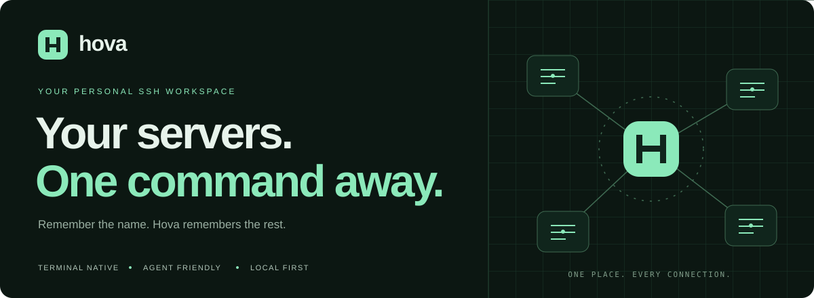
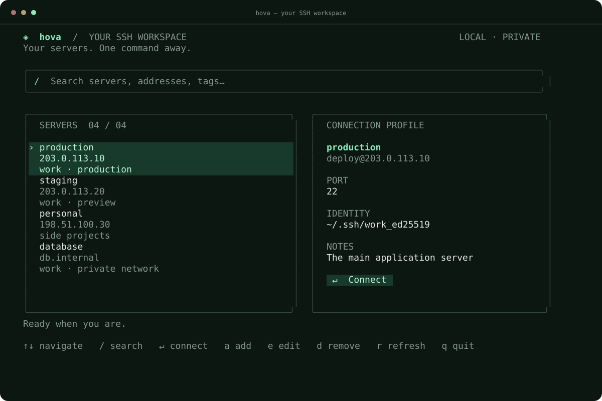

<p align="center">
  
</p>

<p align="center">
  <a href="https://github.com/alzubair-alojali/hova/actions/workflows/ci.yml"></a>
  <a href="https://github.com/alzubair-alojali/hova/releases"></a>
  <a href="LICENSE"></a>
  
</p>

<p align="center">
  A home for every SSH connection.<br />
  Give your servers names. Find them instantly. Connect without remembering an IP.
</p>

<p align="center">
  <a href="#get-hova">Install</a> ·
  <a href="#your-first-connection">Quick start</a> ·
  <a href="#the-workspace">Workspace</a> ·
  <a href="#for-your-agents-too">For agents</a> ·
  <a href="#command-reference">Commands</a>
</p>

<br />



<p align="center"><sub>Rendered from Hova's terminal interface. All server names and addresses above are examples.</sub></p>

## Less remembering. More connecting.

You know which server you need. You just don't remember its address, SSH user, port, or which key you used last time.

Hova keeps those details in a local address book. Run `hova` for a keyboard-driven workspace, or use explicit commands from your shell and AI agents.

| For your terminal | For your workflow |
| :--- | :--- |
| Search names, addresses, tags and notes | Connect directly with `hova connect production` |
| Browse a server list and connection profile | Import the aliases in your SSH config |
| Add and edit with guided forms | Get clean JSON for scripts and agents |
| Resume the workspace after SSH ends | Use your existing SSH keys and agent |

## Get Hova

**Download a binary** from [Releases](https://github.com/alzubair-alojali/hova/releases/latest). Choose your operating system and architecture, extract the archive, and place `hova` (or `hova.exe`) in a directory on your `PATH`. SHA-256 checksums are included with each release.

| System | Archive |
| :--- | :--- |
| Linux, x86-64 | `hova_VERSION_linux_amd64.tar.gz` |
| Linux, ARM64 | `hova_VERSION_linux_arm64.tar.gz` |
| macOS, Intel | `hova_VERSION_darwin_amd64.tar.gz` |
| macOS, Apple Silicon | `hova_VERSION_darwin_arm64.tar.gz` |
| Windows, x86-64 | `hova_VERSION_windows_amd64.zip` |
| Windows, ARM64 | `hova_VERSION_windows_arm64.zip` |

Replace `VERSION` with the release number, such as `0.1.0`. Binaries are unsigned; your operating system may ask you to allow a downloaded application.

**Have Go 1.24 or newer?** Install a pinned version:

```sh
go install github.com/alzubair-alojali/hova/cmd/hova@v0.1.0
```

Make sure Go's binary directory is on your `PATH`. Hova also needs the native **OpenSSH client** (`ssh`) on your `PATH` to make connections. No running service or account is required.

## Your first connection

```sh
# Add a server with a memorable name
hova add production --host 203.0.113.10 --user deploy --tags work,production

# Open the workspace
hova

# Or connect directly
hova connect production
```

Prefer a form? Run `hova add` in an interactive terminal. Hova asks for the connection details and saves them when you press **Ctrl+S**.

Already have an SSH config?

```sh
hova import ssh
hova import ssh --file ~/.ssh/work-config
```

Import reads concrete `Host` aliases from the selected file. It skips wildcard and negated patterns, and keeps existing Hova names. It does not enumerate `Include` files. Connections use the original alias and absolute config path, so OpenSSH still resolves your includes, jump hosts, identity files and other settings. Displayed addresses are metadata from each alias block, not resolved settings or reachability checks.

## The workspace

Run `hova` in an interactive terminal to browse your inventory. Wide windows show a connection profile beside the server list; narrower windows use one column. The workspace requires at least 24 columns and 18 rows; smaller windows pause actions and show resize guidance. Hova uses your terminal background and supports `NO_COLOR`.

| Key | Action |
| :--- | :--- |
| **↑ / ↓** or **k / j** | Select a server |
| **/** | Search names, addresses, users, tags and notes |
| **Enter** | Connect to the selected server |
| **a** | Add a connection |
| **e** | Edit the selected connection |
| **d** | Open a removal confirmation |
| **r** | Reload the inventory |
| **Esc** | Leave search; press again to clear the filter |
| **q** or **Ctrl+C** | Quit |

In forms, **Tab / Shift+Tab** moves between fields, **Ctrl+S** saves, and **Esc** cancels. Enter advances to the next field and saves from the final field. Validation errors keep your input intact.

Opening a connection hands the terminal to native SSH. When your session ends, you return to Hova with the search and selection retained. Running bare `hova` without an interactive terminal prints help.

## Command reference

```sh
hova list
hova list --search database --tag work
hova show production
hova connect production
hova connect production --dry-run --json

hova add staging --host 203.0.113.20 --user ubuntu --port 2222 \
  --identity ~/.ssh/work_key --tags work,staging --notes "Preview environment"

hova edit staging --host 203.0.113.21
hova edit staging --name preview
hova edit preview --tags work,preview
hova edit preview --notes=""
hova remove preview --yes

hova exec production -- 'uptime && df -h'
hova exec production --timeout 60s -- 'systemctl status nginx'

hova config path
hova --version
hova --help
```

The multiline example uses POSIX shell continuation. On PowerShell, put the command on one line.

Edits preserve omitted fields. `--tags` replaces the full tag list; `--tags=""`, `--notes=""`, `--user=""` and `--identity=""` clear those optional fields. Editing an imported profile's host, user, port or identity converts it to a manually configured connection; metadata-only edits retain its SSH alias.

Aliases: `ls` for `list`, `c` for `connect`, `rm` for `remove`. Shell completion is available through `hova completion bash`, `zsh`, `fish`, or `powershell`; each command's help explains how to install it.

## For your agents, too

Hova's CLI gives agents the same named inventory you use. They can inspect a server without opening an SSH connection:

```sh
hova list --json
hova show production --json
hova connect production --dry-run --json
```

`list --json` returns an array, including `[]` for an empty inventory. `show --json` returns a server object. Dry runs return an executable and an argument array, preserving argument boundaries.

Remote execution is explicit:

```sh
hova exec production --json --timeout 30s -- 'uname -a'
```

The command after `--` must be **one quoted remote shell command string**. It runs in the remote user's shell. Hova never evaluates that string in a local shell.

```json
{
  "stdout": "Linux example-host ...\n",
  "stderr": "",
  "exit_code": 0,
  "timed_out": false
}
```

| Contract | Behavior |
| :--- | :--- |
| JSON | No terminal styling, menus, or progress output |
| Command errors | `{"error":"message"}` on stderr with exit code `1` |
| Remote exit | SSH's exit code is preserved; JSON result remains on stdout |
| Timeout | Default `30s`; exit code `124` and `timed_out: true` |
| Authentication | `exec` uses `BatchMode=yes`, `StrictHostKeyChecking=yes`, and a 10-second connection timeout |
| Removal | Requires explicit `--yes` |
| Reads | Listing, inspecting and dry runs never connect |

Before an agent's first execution, connect interactively and verify the server's host-key fingerprint through a trusted source. Agents cannot answer unknown-host or password prompts. A timeout kills the local SSH process; a remote job may continue. JSON captures output in memory; omit `--json` to stream large output.

An instruction you can give your agent:

> Use `hova list --json` to discover server names and `hova show NAME --json` to inspect a connection. Only connect or run remote commands when I ask. Use `hova exec NAME --json --timeout 30s -- 'COMMAND'` for an authorized command, and check `exit_code` and `timed_out` before reporting success.

## Local by default

Your inventory lives outside the repository:

| Platform | Default location |
| :--- | :--- |
| Linux | `$XDG_CONFIG_HOME/hova/servers.json`, or `~/.config/hova/servers.json` |
| macOS | `~/Library/Application Support/hova/servers.json` |
| Windows | `%AppData%\hova\servers.json` |

`hova config path` prints the exact location. Override it with `HOVA_CONFIG` or the higher-priority `--config PATH` flag.

```sh
hova --config ./private-inventory.json list --json
```

The file stores server names, addresses, users, ports, key **paths**, tags, notes, and imported alias references. Hova never stores passwords or private-key contents. Inventories are not encrypted: keep them and backups private. Unix files are created with `0600` permissions; Windows uses your directory's ACLs.

Writes are lock-protected and use temporary-file replacement. Inventories have an 8 MiB size limit; writes that exceed it are rejected. Malformed inventory files produce an error and remain untouched. Concurrent CLI edits merge only the supplied fields; stale interactive forms ask you to refresh. A stale lock error includes the lock's path; remove it only after confirming that no Hova process is writing.

Hova delegates authentication and host-key handling to [OpenSSH](https://www.openssh.com/). Trusted SSH config can run local commands when SSH connects; see [the security model](SECURITY.md).

## Build and contribute

```sh
git clone https://github.com/alzubair-alojali/hova.git
cd hova
go test ./...
go vet ./...
go build -o bin/hova ./cmd/hova
```

On Windows, use `go build -o bin/hova.exe ./cmd/hova`. CI runs on Linux, macOS and Windows. See [CONTRIBUTING.md](CONTRIBUTING.md) for development notes and [SECURITY.md](SECURITY.md) for vulnerability reporting.

Built with [Bubble Tea](https://github.com/charmbracelet/bubbletea), [Bubbles](https://github.com/charmbracelet/bubbles), [Lip Gloss](https://github.com/charmbracelet/lipgloss), and [Cobra](https://github.com/spf13/cobra).

<br />

<p align="center">
  <br />
  <sub>Keep your servers close.</sub><br />
  <sub>MIT © 2026 Alzubair Alojali</sub>
</p>
